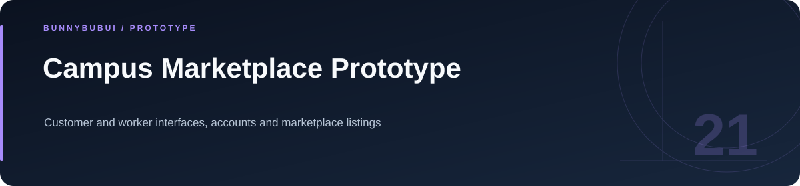
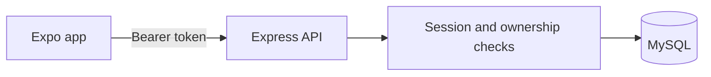

<p align="center">
  
</p>

<h1 align="center">Campus Marketplace Prototype</h1>

<p align="center">Customer and worker interfaces, accounts and marketplace listings</p>

<p align="center">
      
</p>

<p align="center"><a href="#overview">ภาพรวม</a> · <a href="#features">ความสามารถ</a> · <a href="#start">เริ่มใช้งาน</a> · <a href="#structure">โครงสร้าง</a> · <a href="#validation">ตรวจสอบงาน</a></p>

<a id="overview"></a>

## ภาพรวม

ต้นแบบแอปตลาดภายในมหาวิทยาลัย มีหน้าสำหรับลูกค้าและผู้ขาย พัฒนาด้วย Expo/React Native ร่วมกับ Express และ MySQL พร้อมระบบบัญชีและคำสั่งจัดการรายการสินค้า

<a id="features"></a>

## ความสามารถที่มีใน source

| ส่วนงาน | รายละเอียด | อ้างอิง |
|---|---|---|
| **Accounts** | สมัครสมาชิกและตรวจรหัสผ่านด้วย bcrypt | [ดู source](Backend/routes/signIn.js) |
| **Sessions** | สุ่ม bearer token และเก็บ hash พร้อมอายุ | [ดู source](Backend/middlewares/authTokens.js) |
| **Marketplace** | จำกัดการแก้ไขและลบให้เจ้าของรายการ | [ดู source](Backend/routes/market.js) |
| **App screens** | แยกหน้าลูกค้าและผู้ขาย | [ดู source](routes/) |

### เส้นทางการทำงาน



<a id="start"></a>

## เริ่มต้นใช้งาน

**สิ่งที่ต้องมี:** Node.js 22+, MySQL และ Expo; ตั้งค่า backend และนำเข้า schema ก่อนเปิดแอป

```sh
cd Backend
cp .env.example .env
# Configure MySQL, then import wustudents.sql into an empty local database.
npm ci
npm test
npm start

# Terminal 2, from repository root
npm ci
npm run web
```

ฐานข้อมูลเดิมต้องรัน `Backend/sql/001_auth_sessions.sql` ก่อนเริ่ม backend รุ่นนี้ ตั้ง `EXPO_PUBLIC_API_URL` เมื่อใช้เครื่องจริง

<a id="configuration"></a>

## การตั้งค่า

ตัวอย่างค่าตั้งค่าอยู่ในไฟล์ต่อไปนี้ คัดลอกไปยังชื่อไฟล์ local ที่โปรเจกต์อ่านและกำหนดค่าของเครื่องที่ใช้

| ไฟล์ตัวอย่าง | ตัวแปรสำคัญ |
|---|---|
| [.env.example](.env.example) | `EXPO_PUBLIC_API_URL` |
| [Backend/.env.example](Backend/.env.example) | `DB_HOST`, `DB_PORT`, `DB_USER`, `DB_PASSWORD`, `DB_NAME`, `PORT` |

<a id="api"></a>

## API โดยย่อ

| Method | เส้นทาง | หน้าที่ |
|---|---|---|
| POST | `/api/signUp · /api/signIn` | บัญชีและ bearer token |
| POST | `/api/sessionAuth · /api/logout` | ตรวจและเพิกถอน session |
| POST / GET | `/api/add_market · /api/read_market` | รายการสินค้าของผู้ใช้ |
| PUT / DELETE | `/api/update_market/:id · /api/delete_market/:id` | ตรวจเจ้าของรายการก่อนเปลี่ยนข้อมูล |

<a id="structure"></a>

## โครงสร้างที่ควรเริ่มอ่าน

| ตำแหน่ง | หน้าที่ |
|---|---|
| [Backend/](Backend) | backend API |
| [routes/](routes) | หน้าจอและการนำทาง |

<a id="validation"></a>

## คำสั่งและผลตรวจ

| โฟลเดอร์ที่รัน | คำสั่งที่มีใน package |
|---|---|
| `Backend` | `npm run test` |

ดู [ผลตรวจที่บันทึกไว้](docs/VALIDATION.md) สำหรับขอบเขตการทดสอบรอบเตรียมพอร์ต

<a id="scope"></a>

## ขอบเขตของงาน

OTP ในหน้าแอปยังเป็นตัวอย่างในเครื่อง; token ฝั่ง client เก็บใน AsyncStorage ดูข้อจำกัดและขั้นตอนเปลี่ยน schema ในคู่มือ auth

<a id="reading"></a>

## อ่านต่อ

- [บันทึกการเตรียม source](docs/CLEANUP.md)
- [การเปลี่ยนระบบ session](docs/AUTH_MIGRATION.md)


---

<p align="center"><a href="https://github.com/BunnyBubui">BunnyBubui</a> · <a href="https://github.com/BunnyBubui/test">Software Portfolio</a></p>
